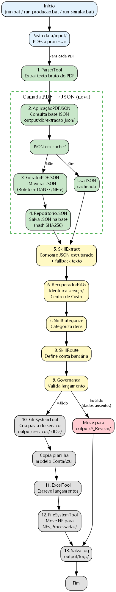
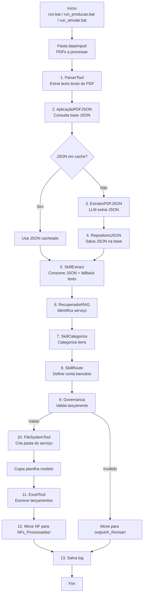

# Fluxo de Execução da Aplicação PDF → JSON

Este documento descreve o fluxo completo de execução do **FIN CRESER** após a inclusão da camada **PDF → JSON estruturado**.



## Resumo

A nova camada fica entre a extração de texto do PDF e o processamento financeiro. Ela converte o PDF em um JSON rico (boleto/duplicata + DANFE/NF-e), persiste em `output/db/extracao_json/` e disponibiliza os dados para as demais etapas do pipeline.

## Etapas do fluxo

### 1. Início
Disparado por um dos arquivos batch:
- `run.bat` — execução padrão
- `run_producao.bat` — produção com OpenAI real
- `run_simular.bat` — execução offline (LLM simulado)

### 2. Entrada de arquivos
O orquestrador lê todos os PDFs da pasta `data/input/`.

### 3. Extração de texto bruto
`ParserTool` → `src/parsers/dispatcher.py` → `PDFParser` extrai o texto usando:
1. `pdfplumber`
2. `PyPDF2` (fallback)
3. OCR `pdf2image` + `pytesseract` (último recurso)

### 4. Camada PDF → JSON (NOVA)

```text
AplicaçãoPDFJSON.obter_ou_extrair(caminho_pdf, texto_bruto)
```

#### 4.1 Consulta à base JSON
`RepositorioJSON` calcula o hash SHA256 do PDF e verifica se já existe um JSON em:

```text
output/db/extracao_json/<hash_sha256>.json
```

#### 4.2 Cache hit
Se o JSON existir, ele é carregado e usado imediatamente — sem chamar o LLM novamente.

#### 4.3 Cache miss
Se não existir:
1. `ExtratorPDFJSON` monta um prompt com o schema completo dos modelos.
2. O LLM (`gpt-4o-mini`) extrai boleto/duplicata + DANFE/NF-e no formato JSON.
3. `RepositorioJSON` salva o resultado na base.

> Em modo simulado, se o LLM não retornar JSON válido, o extrator devolve uma estrutura vazia e o `SkillExtract` mantém seu fallback por regex/texto.

### 5. Extração de dados financeiros
`SkillExtract` consome o JSON estruturado para preencher `DadosExtracao`:
- `fornecedor` → emitente/beneficiário
- `cnpj` → CNPJ do emitente/beneficiário
- `valor` → valor do documento ou total da nota
- `vencimento` → data do boleto
- `numero_nf` → número da NF-e
- `itens` → lista de produtos/serviços

Se o JSON estiver vazio ou incompleto, o extrator mantém a extração tradicional por regex do texto bruto.

### 6. Identificação do serviço
`RecuperadorRAG` identifica o serviço/centro de custo:
1. Primeiro pelo nome do arquivo.
2. Depois pelo conteúdo do texto.

### 7. Categorização
`SkillCategorize` categoriza os itens da NF (alimentação, limpeza, serviços etc.).

### 8. Roteamento financeiro
`SkillRoute` define a conta bancária correta para o serviço.

### 9. Governança
`Governanca.validar_lancamento()` verifica campos obrigatórios:
- Fornecedor
- CNPJ
- Centro de Custo
- Conta Bancária
- Valor > 0

### 10. Saída

#### Sucesso
1. Cria pasta do serviço: `output/servicos/<ID>/`
2. Copia planilha modelo ContaAzul.
3. Escreve lançamentos na planilha.
4. Move o PDF processado para `NFs_Processadas/`.

#### Erro
Move o PDF e o resultado para `output/A_Revisar/`.

### 11. Log
Salva o log da execução em:

```text
output/logs/execucao_YYYY-MM-DD_HHMMSS.json
```

## Diagrama Mermaid



## Arquivos envolvidos

| Arquivo | Papel |
|---|---|
| `src/extracao_json/aplicacao.py` | Fachada `AplicacaoPDFJSON` |
| `src/extracao_json/extrator.py` | Extrai JSON do texto via LLM |
| `src/extracao_json/repositorio.py` | Persiste e consulta JSONs |
| `src/extracao_json/modelos.py` | Schema Pydantic dos documentos |
| `src/skills/extract.py` | Consome JSON para `DadosExtracao` |
| `src/agente/orquestrador.py` | Orquestra o novo fluxo |
| `output/db/extracao_json/` | Base de JSONs extraídos |

## Benefícios do novo fluxo

- **Qualidade**: JSON estruturado com todos os campos do boleto e da DANFE/NF-e.
- **Reprocessamento**: cache por hash evita custos repetidos de LLM.
- **Revisão humana**: JSONs podem ser corrigidos manualmente antes de reprocessar.
- **Compatibilidade**: fallback por regex/texto mantém o sistema funcionando sem OpenAI.
