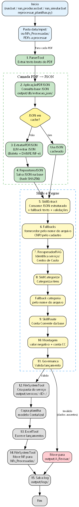
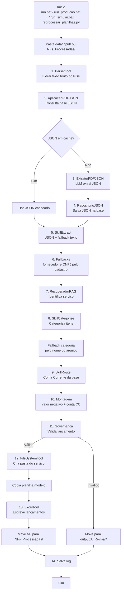

# Fluxo Revisado da Aplicação FIN CRESER

Este documento descreve o fluxo completo e revisado do agente financeiro/fiscal, incluindo as correções de extração, validação e roteamento implementadas.



## Resumo

O pipeline recebe PDFs de Notas Fiscais e/ou boletos, extrai dados estruturados (via LLM + regex), classifica a despesa, identifica o centro de custo, define a conta bancária correta e grava os lançamentos na planilha modelo ContaAzul.

## Etapas do fluxo

### 1. Início

Disparado por um dos comandos:
- `run.bat` — execução padrão
- `run_producao.bat` — produção com OpenAI real
- `run_simular.bat` — execução offline (LLM simulado)
- `reprocessar_planilhas.py` — reprocessa PDFs já movidos para `NFs_Processadas/`

### 2. Entrada de arquivos

O orquestrador lê PDFs de uma das origens:
- `data/input/` — primeira execução
- `output/servicos/<ID>/NFs_Processadas/` — reprocessamento

### 3. Extração de texto bruto

`ParserTool` → `src/parsers/dispatcher.py` → `PDFParser` extrai o texto usando:
1. `pdfplumber`
2. `PyPDF2` (fallback)
3. OCR `pdf2image` + `pytesseract` (último recurso)

### 4. Camada PDF → JSON

```text
AplicacaoPDFJSON.obter_ou_extrair(caminho_pdf, texto_bruto)
```

#### 4.1 Consulta à base JSON
`RepositorioJSON` calcula o hash SHA256 do PDF e verifica se já existe um JSON em:

```text
output/db/extracao_json/<hash_sha256>.json
```

#### 4.2 Cache hit
Se o JSON existir, ele é carregado e usado imediatamente — sem chamar o LLM novamente.

#### 4.3 Cache miss
Se não existir:
1. `ExtratorPDFJSON` monta um prompt com o schema completo dos modelos.
2. O LLM (`gpt-4o-mini`) extrai boleto/duplicata + DANFE/NF-e no formato JSON.
3. Respostas com `null` em campos opcionais são normalizadas para `{}`.
4. `RepositorioJSON` salva o resultado na base.

### 5. Extração de dados financeiros (`SkillExtract`)

`SkillExtract` consome o JSON estruturado **e** o texto bruto para preencher `DadosExtracao`:
- `fornecedor` → emitente da NF-e ou beneficiário do boleto
- `cnpj` → CNPJ validado (dígitos verificadores); aceita CNPJ mascarado de faturas
- `valor` → valor do documento ou total da nota
- `vencimento` → data do boleto; fallback para data de emissão quando ausente
- `numero_nf` → número da NF-e (rejeita chaves de acesso com 44 dígitos)
- `itens` → produtos/serviços da NF-e; descarta lixo de boletos

Se o JSON estiver vazio, incompleto ou inconsistente, o extrator mantém a extração tradicional por regex do texto bruto.

### 6. Fallbacks de enriquecimento

Antes da categorização, o orquestrador aplica fallbacks para corrigir dados ausentes:

#### 6.1 Fornecedor pelo nome do arquivo
Se `fornecedor` estiver vazio, busca em `data/kb/fornecedores.json` por substring no nome do arquivo.

#### 6.2 CNPJ pelo cadastro de fornecedores
Se `cnpj` estiver vazio, busca o CNPJ cadastrado para o fornecedor identificado.

### 7. Identificação do serviço / Centro de Custo

`RecuperadorRAG` identifica o serviço:
1. Primeiro pelo nome do arquivo (mais robusto).
2. Depois pelo conteúdo do texto.

### 8. Categorização

`SkillCategorize` categoriza os itens da NF:
- Usa o mapeamento local de `data/kb/produtos.json`.
- Busca semântica no RAG para itens não mapeados.
- Quando todos os itens são da mesma categoria, usa o **valor total da NF** (não a soma dos itens, evitando perdas).
- Segmenta proporcionalmente quando há categorias mistas.

#### 8.1 Fallback de categoria pelo nome do arquivo
Se a categoria ficar como "A classificar" e o nome do arquivo contiver palavras-chave (ex: `MATER ESCRITORIO`, `PEDAGOGICO`, `VIVO`, `ENERGIA`), a categoria é inferida automaticamente.

### 9. Roteamento financeiro

`SkillRoute` define a conta bancária correta para o serviço:
1. Busca a conta em `data/kb/contas_bancarias.json` via RAG.
2. Aplica `regra_conta_bancaria()` para decidir entre Conta Corrente (CC) e Poupança (PP).
3. **Sempre utiliza o número da Conta Corrente** conforme a base.

### 10. Montagem do lançamento

O orquestrador monta a linha da planilha:
- `Valor` sempre negativo (`-abs(valor)`).
- `Conta Bancária` contém apenas o número da Conta Corrente (ex: `14793-1`).

### 11. Governança

`Governanca.validar_lancamento()` verifica campos obrigatórios:
- Fornecedor
- CNPJ
- Centro de Custo
- Conta Bancária
- Valor > 0 (o valor absoluto é validado antes da inversão de sinal)

### 12. Saída

#### Sucesso
1. Cria pasta do serviço: `output/servicos/<ID>/`
2. Copia planilha modelo ContaAzul.
3. `ExcelTool` escreve os lançamentos.
4. Move o PDF processado para `NFs_Processadas/`.

#### Erro
Move o PDF e o resultado para `output/A_Revisar/`.

### 13. Log

Salva o log da execução em:

```text
output/logs/execucao_YYYY-MM-DD_HHMMSS.json
```

## Diagrama Mermaid



## Arquivos envolvidos

| Arquivo | Papel |
|---|---|
| `src/agente/orquestrador.py` | Orquestra todo o pipeline |
| `src/skills/extract.py` | Extrai e valida dados financeiros |
| `src/skills/categorize.py` | Categoriza itens e segmenta NF mista |
| `src/skills/route.py` | Define centro de custo e conta bancária |
| `src/regras/contas_bancarias.py` | Regra CC vs Poupança |
| `src/regras/governanca.py` | Validação dos lançamentos |
| `src/rag/recuperador.py` | Recuperação de conhecimento do RAG |
| `src/rag/seed.py` | Popula o vector store com a base de conhecimento |
| `src/extracao_json/aplicacao.py` | Fachada `AplicacaoPDFJSON` |
| `src/extracao_json/extrator.py` | Extrai JSON do texto via LLM |
| `src/extracao_json/repositorio.py` | Persiste e consulta JSONs |
| `src/extracao_json/modelos.py` | Schema Pydantic dos documentos |
| `data/kb/contas_bancarias.json` | Base de contas correntes/poupanças |
| `data/kb/fornecedores.json` | Cadastro de fornecedores e CNPJs |
| `data/kb/produtos.json` | Mapeamento de produtos para categorias |
| `data/kb/servicos.json` | Cadastro de serviços/centros de custo |
| `output/db/extracao_json/` | Base de JSONs extraídos |
| `output/servicos/<ID>/Planilha_Modelo_ContaAzul.xlsx` | Planilhas de saída |

## Regras de negócio garantidas

- Conta bancária sempre da base `data/kb/contas_bancarias.json`.
- Apenas número da **Conta Corrente** é preenchido na planilha.
- Valores sempre negativos.
- CNPJ validado ou completado pelo cadastro.
- Número da NF não confundido com chave de acesso.
- Fornecedor não confundido com cliente/pagador (`GFWC CRE-SER`).
- Vencimento preenchido, mesmo que via data de emissão.
